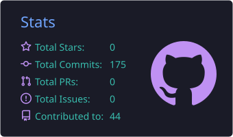
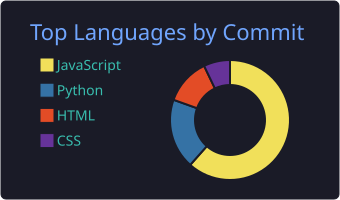

<!-- Save this as README.md in a public repo named exactly: Shrijeet-Ambastha -->

<h1 align="center">Hi there, I'm Shrijeet Ambastha </h1>

  <b>B.Tech Student · Web Developer · Python & ML Enthusiast</b> 
  <i>Building things, breaking things, and learning along the way.</i>

  
  

---

##  About Me

-  B.Tech student, passionate about software development and machine learning
-  Currently focusing on building real-world projects and sharpening my fundamentals
-  Knows: React, full-stack development, System Design, Machine Learning, LLM
-  Open to collaborating on web and ML projects
-  Ask me about: JavaScript, Python, web development, ML basics

---

##  Certifications Earned

| Certification | Issued By | Year | Credential |
|---------------|-----------|------|------------|
|1 Machine Learning | Issuer TuteDude | 2026 | [View]([https://link-to-certificate](https://drive.google.com/file/d/1UOG1Bk598DQDrr2ZK5n0fkQda3HvdGo9/view?usp=sharing)) |
|2 System Design | Issuer TuteDude | 2026 | [View]([https://link-to-certificate](https://drive.google.com/file/d/1fSSjO2q_7_qSWFuED-RKldogIwS1wfFq/view?usp=sharing)) |
|3 AWS Architect | Issuer Amazon Web Services | 2026 | [View]([https://link-to-certificate](https://drive.google.com/file/d/1wY_ppbEgKDqQX99J-4V_2CXtgTTqkhd4/view?usp=sharing)) |

##  Tech Stack

**Languages**

**Frameworks & Libraries**

**Tools**

---

##  Featured Projects

| Project | Description | Tech |
|---------|-------------|------|
| [🪪 TRF Visitor Pass](https://github.com/Shrijeet-Ambastha/TRF-Visitor-pass) | Generates an e-pass for visitors entering TRF Ltd, capturing the required visitor information. |  |
| [🔍 Semantic Search System](https://github.com/Shrijeet-Ambastha/semantic-search-system) | Uses vector embeddings to retrieve results faster and more relevantly. |  |
| [🍔 Food Delivery Time Predictor](https://github.com/Shrijeet-Ambastha/food-delivery-time-predictor) | Predicts expected delivery time based on multiple factors. |  |

---

##  GitHub Stats

  
  

  

---

## 🤝 Let's Connect

  
  
  

<i>⭐ If you like my work, consider giving a repo a star!</i>

